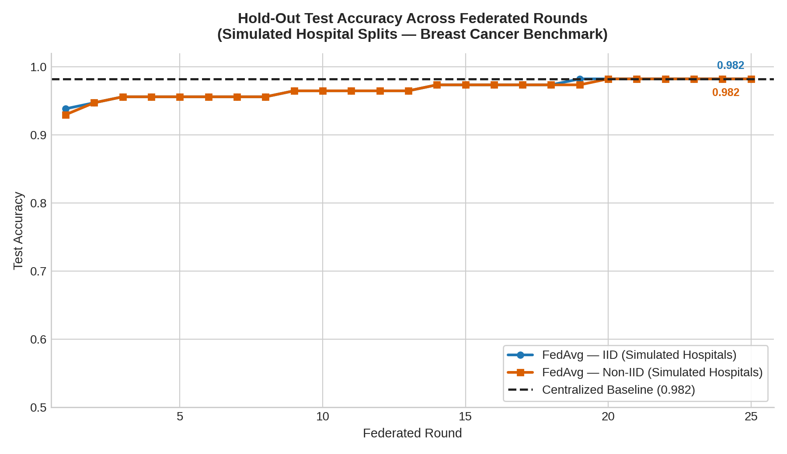
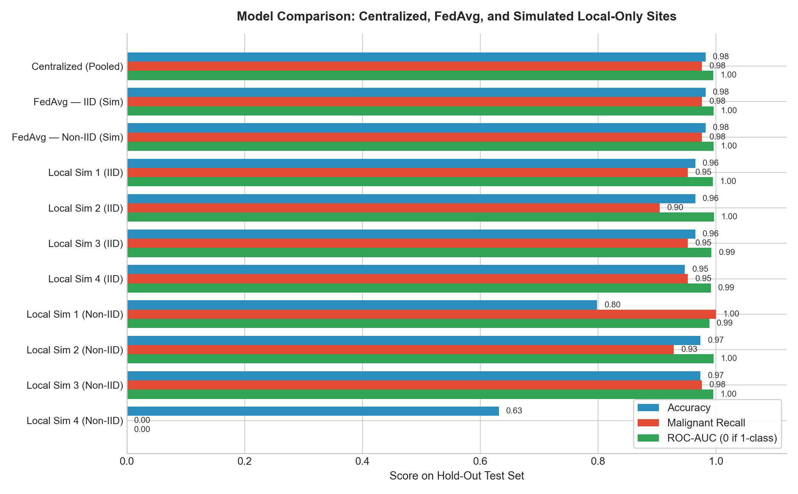
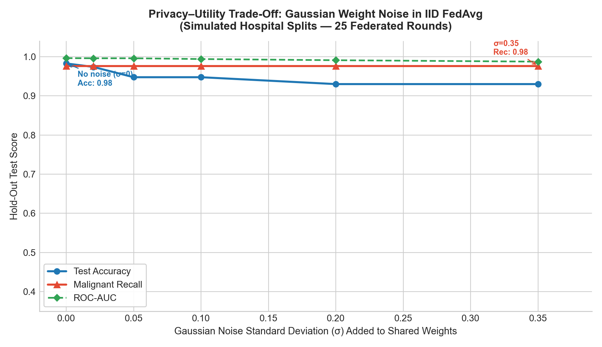

# Simulated Hospital Federated Learning Prototype (Breast Cancer Benchmark)

> **Data disclaimer:** All hospital sites (`Hospital_Sim_1` to `Hospital_Sim_4`) in this project are **simulated** by splitting the public `sklearn.datasets.load_breast_cancer()` benchmark dataset. **No real patient or clinical hospital records are used.** This prototype is for educational and portfolio purposes only and is not for clinical diagnosis.

## Problem and Goal

Healthcare organizations often cannot pool raw patient records in one place because of privacy regulations, institutional governance, and data-sharing barriers. This prototype implements **Federated Averaging (FedAvg)** from scratch in `numpy` across **4 simulated hospital sites**, without sharing raw patient rows, and compares it against:

1. **Centralized training:** logistic regression on pooled training data.
2. **Local-only training:** each simulated site trains independently on its own split.

Both **IID** partitions (unequal random splits) and **non-IID** partitions (unequal splits with skewed malignant/benign balance) are evaluated on a held-out, stratified 20% test set.

## Method

- **Train/test split (`SEED = 42`):** stratified 80/20 split of `load_breast_cancer()` (569 samples, 30 numeric features). The test set (114 patients) is never used for training. In scikit-learn's dataset, `target == 0` is malignant and `target == 1` is benign. In the results below, malignant is treated as the positive class.
- **Simulated hospital partitions (4 sites):**
  - **IID:** a random permutation of the training set divided into unequal site sizes (35%, 25%, 25%, 15%).
  - **Non-IID:** unequal site sizes with skewed malignant/benign ratios (some sites mostly malignant, others mostly benign). A site can end up with a single class.
- **Privacy-aware standardization:** the scaler is not fitted on pooled raw data. The global mean and standard deviation are computed from per-site sample counts, feature sums, and sums of squared deviations around the global mean (summary statistics only).
- **Hand-written FedAvg (`numpy`):** 25 communication rounds, 5 local gradient-descent epochs per round, L2 regularization, learning rate 0.15. Each site trains a binary logistic regression starting from the current global weights `(w, b)`, and the server averages the parameters weighted by each site's sample count.
- **Optional Gaussian noise experiment:** zero-mean Gaussian noise N(0, sigma^2) is added to the aggregated global weights at several noise levels to illustrate how weight perturbation affects accuracy.

Sanity check: FedAvg with a single site holding all training data reproduces centralized gradient descent (identical accuracy, recall, and ROC-AUC).

## Results

Single stratified split (seed 42), 114 test patients. Malignant is the positive class.

| Model / Setup                   | Data Split          | Test Accuracy | Malignant Recall | ROC-AUC |
| ------------------------------- | ------------------- | ------------- | ---------------- | ------- |
| Centralized Logistic Regression | Pooled train        | 0.9825        | 0.9762           | 0.9954  |
| FedAvg                          | IID (simulated)     | 0.9825        | 0.9762           | 0.9960  |
| FedAvg                          | Non-IID (simulated) | 0.9825        | 0.9762           | 0.9960  |
| Local only, Site 1              | IID                 | 0.9649        | 0.9524           | 0.9950  |
| Local only, Site 2              | IID                 | 0.9649        | 0.9048           | 0.9970  |
| Local only, Site 3              | IID                 | 0.9649        | 0.9524           | 0.9924  |
| Local only, Site 4              | IID                 | 0.9474        | 0.9524           | 0.9914  |
| Local only, Site 1              | Non-IID             | 0.7982        | 1.0000           | 0.9888  |
| Local only, Site 2              | Non-IID             | 0.9737        | 0.9286           | 0.9960  |
| Local only, Site 3              | Non-IID             | 0.9737        | 0.9762           | 0.9957  |
| Local only, Site 4              | Non-IID             | 0.6316        | 0.0000           | N/A †   |

† Site 4's non-IID split contained only one class, so its local model never saw a malignant case and ROC-AUC could not be computed. Its accuracy (0.6316) equals the share of benign patients in the test set, which is what a model that predicts "benign" for everyone would score.

**What stands out:** with non-IID data, sites that train alone can fail badly (Site 4 detected 0% of malignant cases, and Site 1 reached only 79.8% accuracy), while federated training reached 0.9762 malignant recall without sharing raw patient rows. On this single split, federated and centralized training score the same. One test patient is worth about 0.9 percentage points of accuracy, so small differences between methods are not meaningful.

### Noise experiment (IID sites, one run per noise level)

| Noise sigma | Test Accuracy | Malignant Recall | ROC-AUC |
| ----------- | ------------- | ---------------- | ------- |
| 0.00        | 0.9825        | 0.9762           | 0.9960  |
| 0.02        | 0.9737        | 0.9762           | 0.9957  |
| 0.05        | 0.9474        | 0.9762           | 0.9957  |
| 0.10        | 0.9474        | 0.9762           | 0.9937  |
| 0.20        | 0.9298        | 0.9762           | 0.9907  |
| 0.35        | 0.9298        | 0.9762           | 0.9871  |

Accuracy falls from 0.9825 to 0.9298 as noise increases, while malignant recall stays at 0.9762 and ROC-AUC changes only slightly. Each noise level was run once, so differences of one or two patients should not be over-interpreted.

### Figures



*Hold-out test accuracy across federated rounds for IID and non-IID simulated hospitals, compared with the centralized baseline.*



*Accuracy, malignant recall, and ROC-AUC for centralized, federated, and local-only models.*



*Effect of Gaussian noise on the shared weights on test accuracy, malignant recall, and ROC-AUC.*

## Key Takeaways and Remaining Privacy Risks

- **Measured here:** on this split, FedAvg matched centralized training on both IID and non-IID partitions, and clearly outperformed local-only training on the skewed sites. For logistic regression, which is a convex model, non-IID data did not hurt FedAvg in this experiment.
- **Background, not shown by this experiment:** with harder, non-convex models, skewed class distributions can cause local updates to drift in conflicting directions ("client drift"), which can slow convergence or reduce accuracy.
- **Privacy risks that remain:** sharing model parameters or summary statistics instead of raw rows **does not guarantee privacy**. Updates can still leak information through model inversion, membership inference, or class-distribution cues. Plain FedAvg has no formal differential privacy guarantee or secure aggregation unless it is combined with update clipping, calibrated noise (for example DP-SGD), and cryptographic aggregation.

## Limitations

- **Simulated data and partitions:** the 4 hospitals are splits of one public dataset (569 rows), not real multi-center cohorts with domain shift, missing data, or different record formats.
- **Single split:** results come from one train/test split with 114 test patients, so they are noisy. Repeating the experiment over many random splits would give more reliable estimates.
- **Simple model:** logistic regression is fast and transparent, but non-linear models behave differently under non-IID skew.
- **Noise is not differential privacy:** adding Gaussian noise to the aggregated weights illustrates a privacy-accuracy trade-off. It is not a formal (epsilon, delta) differential privacy guarantee, and it perturbs only the global model, not each site's update before sharing.

## Planned Improvements

- Evaluate over 20 random splits and report mean and standard deviation.
- Add a centralized baseline that uses the same optimizer and number of epochs.
- Add noise to each site's update before sharing, and average over multiple noise seeds.
- Try FedProx as a remedy for non-IID drift.

## How to Run

1. Clone the repository and install the dependencies:
   ```bash
   git clone https://github.com/UsmanUmair1/fedavg-breast-cancer-sim.git
   cd fedavg-breast-cancer-sim
   pip install -r requirements.txt
   ```
2. Open `federated_breast_cancer.ipynb` in Jupyter, VS Code, or Google Colab.
3. Run all cells in order. The printed metrics will match the tables above (seed 42), and the figures are saved to `figures/`.

## Repository Contents

- `federated_breast_cancer.ipynb`: the full experiment
- `requirements.txt`: Python dependencies
- `figures/`: generated plots
